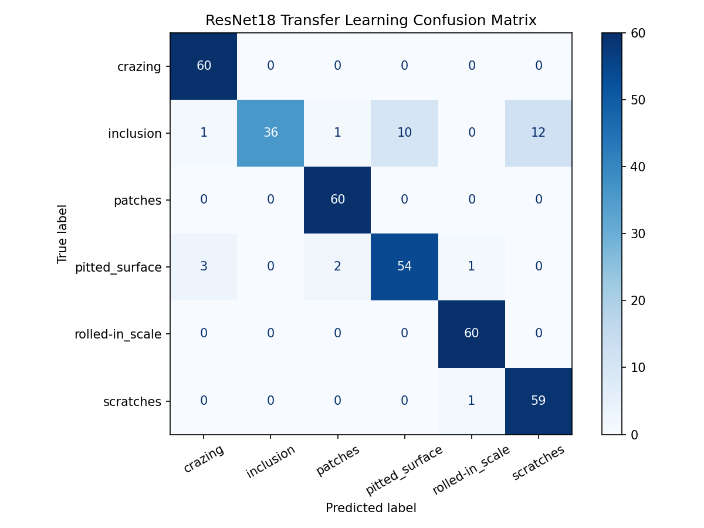
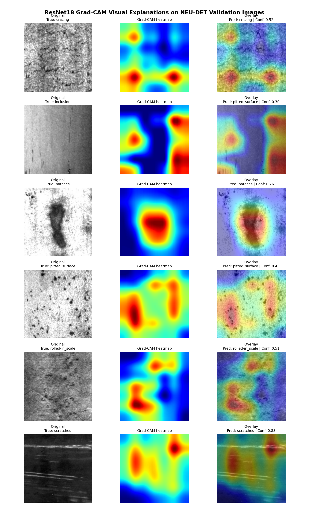
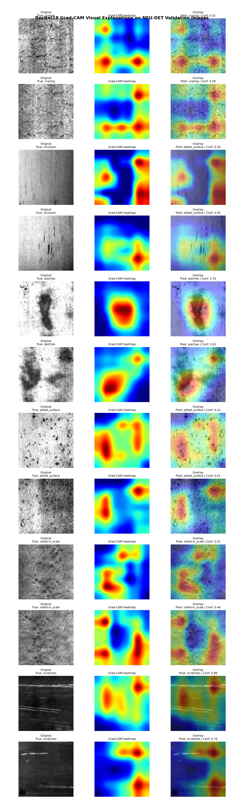
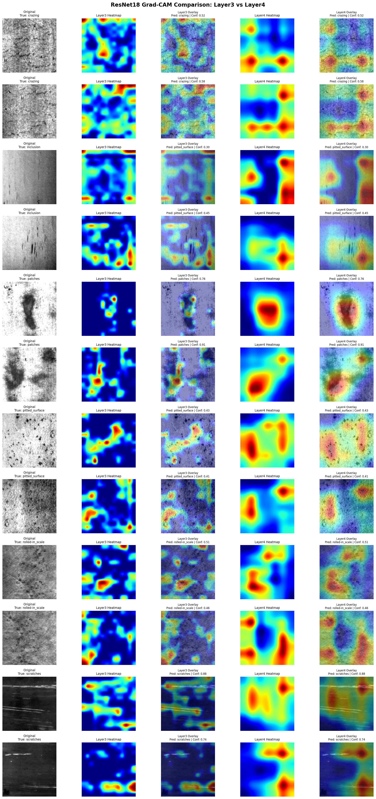

# Industrial Surface Defect Classification

This repository compares a small convolutional neural network with a ResNet18
transfer-learning baseline for classifying six hot-rolled steel surface defects
from the NEU-DET dataset.

In the current recorded run, the baseline CNN reached `0.8861` validation
accuracy and `0.8841` macro F1. The frozen-backbone ResNet18 reached `0.9139`
validation accuracy and `0.9081` macro F1. That is a measurable improvement, but
the class-level report still exposes an important weakness: ResNet18 recall for
`inclusion` is only `0.60`.

| Model | Selected epoch | Validation accuracy | Macro F1 |
|---|---:|---:|---:|
| Baseline CNN | 14 | 0.8861 | 0.8841 |
| ResNet18 transfer learning | 10 | 0.9139 | 0.9081 |


The project is an image-classification baseline for one provided validation
split. It is not a production inspection system, and the reported validation
scores are not independent test-set estimates.

## Dataset and task

The experiments use the
[NEU surface defect database](https://faculty.neu.edu.cn/songkechen/zh_CN/zhym/263269/list/index.htm).
NEU-DET contains 1,800 grayscale images covering six defect classes:

- `crazing`
- `inclusion`
- `patches`
- `pitted_surface`
- `rolled-in_scale`
- `scratches`

This repository uses 240 images per class for training and 60 per class for
validation:

| Split | Images | Images per class |
|---|---:|---:|
| Train | 1,440 | 240 |
| Validation | 360 | 60 |
| Total | 1,800 | 300 |

The raw dataset is not redistributed. Place it locally using this layout:

```text
data/raw/NEU-DET/
├── train/
│   └── images/
│       ├── crazing/
│       ├── inclusion/
│       ├── patches/
│       ├── pitted_surface/
│       ├── rolled-in_scale/
│       └── scratches/
└── validation/
    └── images/
        ├── crazing/
        ├── inclusion/
        ├── patches/
        ├── pitted_surface/
        ├── rolled-in_scale/
        └── scratches/
```

The detection annotations distributed with NEU-DET are not used; the current
task is image-level classification only.

Dataset reference:

> K. Song and Y. Yan, “A noise robust method based on completed local binary
> patterns for hot-rolled steel strip surface defects,” *Applied Surface
> Science*, vol. 285, pp. 858–864, 2013.
> [doi:10.1016/j.apsusc.2013.09.002](https://doi.org/10.1016/j.apsusc.2013.09.002)

## Models

### Baseline CNN

The baseline is trained from scratch on `128 × 128` grayscale images. It uses
three convolution and max-pooling blocks followed by dropout and a two-layer
classifier.

### ResNet18 transfer learning

The transfer-learning model converts each image to three channels, resizes it to
`224 × 224`, and applies ImageNet normalization. ResNet18 backbone weights and
BatchNorm running statistics remain frozen; only the replacement six-class
classification head is optimized.

The pretrained weights are downloaded automatically by torchvision on the first
run.

## Evaluation workflow

Both training scripts use validation accuracy for checkpoint selection. After
training, each script reloads its highest-accuracy checkpoint. The reported
metrics and confusion matrix are generated from that selected model, while the
history table and training curves cover the complete run:

- validation accuracy and macro F1 in a JSON metrics file;
- per-epoch loss and accuracy in a CSV history file;
- a confusion matrix;
- training curves.

`src/create_model_comparison.py` reads those JSON files instead of embedding
result values in source code. Exact values for a regenerated run are stored in:

```text
results/baseline_cnn_metrics.json
results/resnet18_metrics.json
results/model_comparison.csv
```

Because the same validation split is used for checkpoint selection and reporting,
these values should be read as development-set results. A separate untouched
test set or repeated cross-validation would be needed for a stronger estimate of
generalization.

## Visual results

### Confusion matrices




The committed run shows that `inclusion` and `pitted_surface` are frequent sources
of confusion. ResNet18 improves some of those cases but introduces other
tradeoffs, so the transfer-learning baseline is not uniformly better across
classes.

### Prediction examples


The prediction grid uses a small balanced subset of validation images and includes
both correct and incorrect examples. It is qualitative evidence, not an additional
evaluation split.

### Grad-CAM Examples

Grad-CAM was used to visualize the image regions that contributed
to ResNet18 classification predictions.

The original implementation provides one example per defect class.



### Extended Grad-CAM Visualization: 12 Examples

The visualization script was modified to generate two examples
from each of the six steel surface defect categories, resulting
in 12 Grad-CAM visualizations.



The extended visualization allows additional qualitative
observations across images belonging to the same defect class.

The examples show that the model correctly classifies the
selected crazing, patches, pitted surface, rolled-in scale,
and scratches images. However, both selected inclusion images
are incorrectly classified as pitted surface.

These observations highlight the importance of examining
individual predictions in addition to overall classification
performance.

Grad-CAM heatmaps indicate regions contributing to model
predictions, but they do not provide a quantitative measure
of defect localization accuracy.

## Reproduce the workflow

Create an environment and install the direct dependencies:

```bash
python3 -m venv .venv
source .venv/bin/activate
python -m pip install --upgrade pip
python -m pip install -r requirements.txt
```

After placing the dataset in the expected layout, run:

```bash
python src/inspect_dataset.py
python src/train_baseline_cnn.py
python src/train_resnet18.py
python src/create_model_comparison.py
python src/create_prediction_examples.py
python src/create_gradcam_examples.py
```

The training scripts save checkpoints under `models/`; this directory and the
raw dataset are ignored by Git. Generated tables and figures under `results/`
are the public evidence for the committed experiment.

PyTorch installation can depend on the operating system and accelerator. For a
CUDA-specific setup, use the command generated by the
[official PyTorch installer](https://pytorch.org/get-started/locally/) before
installing the remaining requirements.

### Reproduce the Extended Grad-CAM Experiment

To reproduce the extended visualization, open:

`src/create_gradcam_examples.py`

Set:

`EXAMPLES_PER_CLASS = 2`

Update the output filename to:

`gradcam_resnet18_12_examples.png`

Then run:

`python src/create_gradcam_examples.py`

The generated visualization will be saved in the
`results/` directory.

## Repository structure

```text
industrial-surface-defect-classification/
├── data/raw/                    # local NEU-DET files; not tracked
├── models/                      # generated checkpoints; not tracked
├── results/                     # committed metrics and visual evidence
├── src/
│   ├── inspect_dataset.py
│   ├── train_baseline_cnn.py
│   ├── train_resnet18.py
│   ├── create_model_comparison.py
│   ├── create_prediction_examples.py
│   └── create_gradcam_examples.py
├── LICENSE
├── README.md
└── requirements.txt
```

### Additional Experimental Outputs

The following visualization was generated as part of the
student project extension:

- `results/gradcam_resnet18_12_examples.png`:
  Extended Grad-CAM visualization containing two examples
  per defect category.

The original Grad-CAM visualization remains available at:

- `results/gradcam_resnet18_examples.png`

Experimental metrics, confusion matrices, and training
curves are stored in the `results/` directory.

## Limitations

- The dataset is small and contains only one steel-surface image domain.
- The validation split is reused for model selection and reporting.
- No untouched test set, repeated split, or cross-dataset evaluation is included.
- Only image-level classification is evaluated; defect localization is not.
- ResNet18 is used as a frozen-backbone baseline rather than a fine-tuned model.
- Grad-CAM covers a small qualitative subset and is not a reliability guarantee.
- Deployment latency, memory use, calibration, and behavior under lighting or
  camera shift have not been measured.

The next meaningful experiment would be an independent evaluation protocol or
controlled partial fine-tuning with the same split and reporting rules—not more
presentation-only output.

## Student Project Extension: Explainable Steel Surface Defect Classification

### Project Objective

This student project explores Explainable Artificial Intelligence (XAI) for steel surface defect classification using ResNet18 and Gradient-weighted Class Activation Mapping (Grad-CAM).

The primary objective is to investigate how Grad-CAM visualizations help interpret image classification predictions and identify possible classification errors across different steel surface defect categories.

### Experimental Setup

The project uses the NEU Surface Defect Database, containing 1,800 grayscale images distributed equally across six defect categories.

The original repository provides two classification models: a baseline CNN and a ResNet18 transfer-learning model.

The experiments use 1,440 training images and 360 validation images.

### Model Performance

The recorded model evaluation results are summarized below:

| Model | Validation Accuracy | Macro F1 |
|---|---:|---:|
| Baseline CNN | 88.61% | 0.8841 |
| ResNet18 | 91.39% | 0.9081 |

ResNet18 achieves a higher validation accuracy than the baseline CNN by approximately 2.78 percentage points.

However, the confusion matrix reveals that the classification performance varies across defect categories. In particular, inclusion remains challenging, with only 36 out of 60 validation images correctly classified by ResNet18.

### Additional Grad-CAM Experiment

The Grad-CAM visualization was extended from one image per class to two images per class, producing 12 examples across the six defect categories.

The additional examples allow qualitative comparison of activation patterns among different images belonging to the same defect category.

The visualizations demonstrate both correct and incorrect classification cases. In particular, two selected inclusion images are misclassified as pitted surface, illustrating the model's difficulty distinguishing certain defect textures.

### Key Findings

1. ResNet18 achieves higher overall validation accuracy than the baseline CNN.
2. Classification performance differs across the six steel surface defect categories.
3. Inclusion is one of the most challenging categories for ResNet18.
4. Grad-CAM provides visual information about the regions contributing to classification predictions.
5. Examining multiple examples helps reveal variations in model attention and classification behavior.

### Limitations and Future Work

The additional Grad-CAM analysis is qualitative and does not establish quantitative localization accuracy.

The evaluation also relies on a validation dataset used during checkpoint selection rather than an independent test dataset.

Future work could investigate Grad-CAM explanations across different convolutional layers, compare correct and incorrect predictions systematically, and evaluate model generalization on an independent test set.

### Original Repository and Acknowledgment

This student project builds upon the original Industrial Surface Defect Classification repository developed by amirhossein-sadeghi2003.

Original repository:

https://github.com/amirhossein-sadeghi2003/industrial-surface-defect-classification

The original implementation, model training procedures, and supporting code are acknowledged. The extended Grad-CAM visualization is documented as an additional student experiment.

## Additional Experiment: Grad-CAM Comparison Between ResNet18 Layer3 and Layer4

### Objective

This experiment investigates how different convolutional layers influence Grad-CAM explanations in ResNet18-based steel surface defect classification.

The purpose is to compare the spatial activation patterns produced by two different feature extraction stages of the same trained model.

### Experimental Setup

The experiment uses the previously trained ResNet18 checkpoint and the NEU-DET validation dataset.

Two images are selected from each of the six defect classes, resulting in 12 validation images.

Grad-CAM is generated using two target layers:

- Layer3: `model.layer3[-1]`
- Layer4: `model.layer4[-1]`

The model checkpoint, input images, preprocessing, predicted classes, and model parameters remain unchanged.

Only the target convolutional layer used for Grad-CAM visualization is modified.

### Visualization Results



The visualization compares the original images, Grad-CAM heatmaps, and overlay images generated from Layer3 and Layer4.

### Analysis and Interpretation

The Grad-CAM comparison revealed noticeable differences in the spatial activation patterns generated by ResNet18 Layer3 and Layer4. Layer3 generally produced more detailed and fragmented activation regions, whereas Layer4 generated smoother and broader activation patterns. These differences are consistent with the spatial resolutions of the two layers, with Layer3 producing 14 × 14 feature maps and Layer4 producing 7 × 7 feature maps for a 224 × 224 input image.

For the **patches** category, Layer3 highlighted smaller regions within the visible dark surface defects, while Layer4 emphasized broader areas covering substantial portions of the defect patterns. Similarly, for the **scratches** category, Layer3 showed several activations along the horizontal scratch structures, whereas Layer4 produced more spatially extensive activation regions that did not always closely follow the visible scratches.

For **crazing**, **pitted surface**, and **rolled-in scale**, Layer3 generally displayed multiple localized activation regions, while Layer4 showed smoother and less fragmented responses. These observations suggest that the target convolutional layer influences the spatial granularity of Grad-CAM explanations.

Among the 12 selected validation images, **10 were correctly classified and two were incorrectly classified**. Both incorrectly classified images belonged to the **inclusion** category and were predicted as **pitted surface**, with confidence scores of approximately 0.30 and 0.45. Layer3 generated several localized activations, whereas Layer4 highlighted broader regions, including portions near the image boundaries.

Importantly, changing the Grad-CAM target layer did not change the predicted classes or confidence scores because the same trained ResNet18 checkpoint and input images were used. The experiment therefore demonstrates that selecting different convolutional layers affects the visual explanations rather than the classification decisions themselves.

Overall, Layer3 provided more spatially detailed activation patterns, while Layer4 produced smoother and broader responses. However, higher spatial resolution does not necessarily indicate better explanation quality or more accurate defect localization. Without ground-truth localization evaluation, neither layer can be considered definitively superior.

#### Summary of Class-Specific Observations

| Defect Class | Layer3 Grad-CAM | Layer4 Grad-CAM | Selected Predictions |
|---|---|---|---|
| Crazing | Fragmented activations across the surface | Smoother, more concentrated regions | 2 correct |
| Inclusion | Several localized responses, including edge regions | Broader responses, partly near image boundaries | 2 incorrect |
| Patches | Smaller activations around visible dark defects | Broader activation covering major defect regions | 2 correct |
| Pitted Surface | Multiple localized responses near surface irregularities | Smoother and more extensive activation regions | 2 correct |
| Rolled-in Scale | Scattered and fragmented responses | Broader and less fragmented activations | 2 correct |
| Scratches | Activations partly following horizontal scratch patterns | Broader responses not always aligned with scratches | 2 correct |

**Note:** These observations are based on 12 selected validation
images and represent qualitative comparisons rather than
quantitative defect localization performance.

### Reproducing the Experiment

After preparing the dataset, installing the required Python packages, and restoring the trained ResNet18 checkpoint, run:

`python src/compare_gradcam_layers.py`

The experiment generates:

- `results/gradcam_layer3_vs_layer4.png`
- `results/gradcam_layer_comparison.csv`

### Limitations

The comparison is based on a small qualitative subset of validation images.

Grad-CAM visualizations are not ground-truth defect segmentation masks. Therefore, the experiment does not establish which target layer provides more accurate defect localization.

The normalized high-activation fractions are descriptive indicators rather than quantitative measures of explanation quality.

### Contribution

This experiment extends the original repository by introducing a controlled comparison of Grad-CAM explanations at two different ResNet18 convolutional layers.

It provides additional qualitative evidence about how feature extraction depth influences the visual interpretation of steel surface defect predictions.

## License

The repository code is available under the MIT License. The NEU-DET dataset is
not included and remains subject to its original distribution terms.
